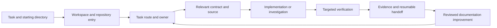

**Engineering agent documentation for greater efficiency and capability**

Prepared 22 October 2026. Scope: the local 0SFS, FOSS Earth and UMN-VR workspaces, with recommendations for future coding agents and the people maintaining their instructions.

**The highest-value improvement is to make the existing documentation reliably actionable.** The workspaces already have concise organization entry points and task-based navigation. Future agents would benefit most from dependable startup discovery, accurate ownership and command routes, explicit verification requirements, and documentation that identifies its source and current status. Those changes reduce repeated investigation while helping agents complete more demanding work correctly.

This report extends the existing [shared documentation-system proposal](/Users/felg/gh/foss-earth/docs/docs/proposals/documentation-system.md:1), especially its agent experience, schemas and freshness checks. It adds a concrete defect backlog, operating contracts, evaluation cases and an adoption sequence. The suggested interfaces and examples below are proposed designs. The user requested a report; implementation of the recommendations is a subsequent activity.

**The audit covered the instruction inventory and selected workflows across all three organizations.** It counted agent entry files, inspected shared policies and repository overlays, compared guidance with manifests and source, and examined the existing context helper and link checker. Three parallel reviews covered the individual workspaces. Detailed reading concentrated on startup, ownership, tests, WASM work, tour content and handoffs. This was a documentation and source audit; it did not establish application correctness or measure agent speedups.

| Local organization directory | Direct child Git checkouts | AGENTS.md files | CLAUDE.md files | Total AGENTS.md bytes |
| --- | ---: | ---: | ---: | ---: |
| `0sfs` | 31 | 31 | 1 | 9,746 |
| `foss-earth` | 26 | 26 | 0 | 10,124 |
| `UMN-VR` | 11 | 11 | 10 | 5,960 |
| Total | 68 | 68 | 11 | 25,830 |

Counts include hidden organization `.github` repositories. The filesystem walk excluded `.git`, dependency directories, build output, distributions, vendor directories and virtual environments, and did not follow directory symlinks. All 68 direct child Git checkouts have an `AGENTS.md`. No checked-in `SKILL.md` was found within the scanned trees. The three organization container directories have no root `AGENTS.md`; the visible `0sfs/.agents/skills` directory is empty. Installed personal or plugin skills are outside this inventory. These byte totals describe files on disk, not the context loaded for one task.

**1. Preserve the existing foundation and optimize the decisions it supports.** Each organization's shared entry point is approximately 2.4–2.5 KB and routes by task. The [0SFS entry point](/Users/felg/gh/0sfs/.github/AGENTS.md:1) already protects uncommitted work, limits costly laptop checks, restricts publishing, and tells agents to open only relevant guides. The [shared task index](/Users/felg/gh/foss-earth/docs/docs/agent-start.md:1) identifies component owners. The [context helper](/Users/felg/gh/foss-earth/docs/scripts/agent-context.mjs:1) lists headings, scripts, exports and document paths without preloading their bodies. These are useful design choices to retain.

Evaluate documentation by its contribution to completed, verified tasks. Track total time and cost across discovery, execution, verification, integration, retries and human intervention. A short file that leaves an agent guessing can increase that total. A slightly longer, precise contract can reduce it. Documentation should also enable difficult tasks by exposing architectural constraints, known failure modes, reproducible fixtures and credible completion criteria.

The target is higher qualified task success at acceptable cost. Do not assign invented savings percentages to the changes below. Establish a baseline and compare the complete task outcomes.

**2. Make instruction discovery work from every supported starting location.** Most repository entry files point to a sibling `.github/AGENTS.md`. That is an explicit reading route, but `.github` is a separate repository and its instructions are not automatically inherited through the filesystem hierarchy. Starting from an organization container introduces another gap: there is no local root entry point.

Codex's documented discovery builds a chain at startup: global guidance, then one selected instruction file per directory from the project root to the working directory. `AGENTS.override.md` takes precedence over `AGENTS.md`; later directories override earlier guidance. When no project root is found, discovery checks the current directory. The documented combined size limit defaults to 32 KiB. A sibling checkout or a Markdown link is outside this automatic discovery chain. Verify each supported host's behavior during onboarding. [Official instruction-discovery documentation](https://learn.chatgpt.com/docs/agent-configuration/agents-md).

Have the developer installer generate a small workspace entry point in each organization container. It should identify the directory as a collection of repositories, direct the agent to the organization policy, and locate the repository map. Keep repository entries independently usable for single-repository clones. Include the essential local safeguards and a deliberate, resolvable path to the full policy.

Support both adjacent-checkout and standalone-clone operation. A minimal policy snapshot or versioned policy artifact can provide an offline fallback, with its source revision and synchronization check. Avoid relying on a network fetch of a moving branch as the only way to obtain essential rules. Treat global personal preferences as user configuration; repository onboarding should not silently rewrite them.

Acceptance: launch a fresh session from each organization container, a representative repository root, a nested source directory and an isolated clone. Ask for the instruction sources and owning repository before any write. Verify that essential safeguards are available and that unrelated repository instructions are absent. Include an override-file case so precedence is tested explicitly.

**3. Repair misleading routes before expanding the documentation system.** The following defects have direct source evidence. Their effects on future agent behavior are inferred risks; the audit did not run a controlled agent experiment for each one.

| Finding and evidence | Consequence | Recommended repair |
| --- | --- | --- |
| [Earth navigation](/Users/felg/gh/foss-earth/docs/navigation.md:33) assigns application composition to `foss-earth.github.io`; the [agent owner map](/Users/felg/gh/foss-earth/docs/docs/agent-start.md:30) distinguishes `app` from website hosting. | An agent can investigate or edit the wrong owner. | Generate both views from one reviewed owner record. |
| [Setup guidance](/Users/felg/gh/foss-earth/docs/setup.md:6) names the website as the globe app and `0sfs/simulator` as Flight. It also lists `check:conformance` and `check:attribution`, which are absent from the [current Docs manifest](/Users/felg/gh/foss-earth/docs/package.json:25). | Setup and verification instructions can fail in the current checkout. | Identify the current owner and distinguish currently available commands from commands requiring a prepared release/tooling environment. |
| [Tour guidance](/Users/felg/gh/UMN-VR/tour/docs/agent-reference.md:3) resolves `README.md` and `docs/...` relative to its own `docs/` location. | Several local task routes lead to nonexistent paths. | Repair relative targets and check links from their actual source document location. |
| [Tour scene instructions](/Users/felg/gh/UMN-VR/tour/docs/agent-reference.md:13) recommend full `build:scene`; the [README](/Users/felg/gh/UMN-VR/tour/README.md:119) documents removed dependencies and provides `--poses-only`, followed by `campus-scenes`. | A content change can trigger a known failing media rebuild. | Route placement edits to the working narrow command and expose the full rebuild's blocker. |
| The former shared Rust workspace's `AGENTS.md` said threaded/shared builds were unimplemented while its README documented the integrated threaded sky path. The cores have since moved to each owner's `*-WASM/` folder; the shared build is now described in [sky-WASM's README](/Users/felg/gh/foss-earth/sky/sky-WASM/README.md:25). | An agent can plan redundant work or reason from an obsolete capability limit. | Keep the durable parity rules in AGENTS and move mutable capability status into a source-backed record. |
| [Flight scripts](/Users/felg/gh/0sfs/fly/package.json:27) allow `--passWithNoTests`. Libraries such as [Autopilot](/Users/felg/gh/0sfs/autopilot/README.md:5) rely on the host application's test runner. | A successful exit can be mistaken for verification of the changed library. | Record the runner owner, explicit scope, and observed test count; distinguish an empty selection from a passing test run. |
| [Flight split guidance](/Users/felg/gh/0sfs/docs/repository-split.md:33) requires installation with `--ignore-scripts`; [Fly's README](/Users/felg/gh/0sfs/fly/README.md:12) gives a plain install route. | Setup can invoke lifecycle effects that another current guide says to avoid. | Resolve the intended install contract with the owner and generate command references from that decision. |
| [A performance handoff](/Users/felg/gh/UMN-VR/tour/docs/performance-next-agent.md:3) describes a request's authorization for autonomous work and long testing. | A future agent may carry task-specific permission into a different task. | Record that authorization as historical session context and require current scope to determine actions. |

The source branches contain ongoing work. In particular, the shared agent index, context helper and documentation-system proposal were locally untracked during the audit. Their local availability is useful evidence; their publication and availability to a fresh remote clone remain unverified. Put public-route qualification into the release process.

**4. Give each important repository a small, useful local contract.** Many repository files currently provide only a five-line redirect. In 0SFS, 28 of the 30 non-organization entries have that form. That keeps policy consistent but supplies little information about the local owner, unusual commands or integration dependencies.

Add information only when it changes a likely decision: the repository's purpose, public entry points, consumer boundaries, generated files, unusual setup requirements and the shortest meaningful verification route. A component whose tests run in Fly should say so directly and link to the relevant test configuration. A repository with unique assets should identify the protected source and rebuild path. Use nested instructions where a substantial subdirectory has different constraints, with host discovery behavior tested rather than assumed.

The [Makerspaces entry](/Users/felg/gh/UMN-VR/makerspaces/AGENTS.md:5) is a useful example: it identifies an unlisted prototype, protects existing tour pages, distinguishes scene generation from content editing, and names the narrow publishing destination. Preserve such exceptions when standardizing templates. Annotate reserved repositories in the owner map as well: [Engine sound](/Users/felg/gh/0sfs/engine-sound/README.md:3) and [Wind noise](/Users/felg/gh/0sfs/wind-noise/README.md:3) currently direct implementation work to `sound`. A repository's name alone should not imply it owns a shipped implementation.

A proposed local entry can be a short paragraph and task table. For each route, identify the trigger, owner/path, required reference and verification workflow ID. Avoid maintaining a complete file listing in prose. Generate changing inventory from manifests and exports, while humans author why the boundary exists.

**5. Separate durable instructions, current facts and task memory.** These materials have different maintenance needs and authority:

| Material | Appropriate home | Update trigger |
| --- | --- | --- |
| Durable policy and non-obvious invariants | Authored AGENTS and scoped reference guides | A reviewed policy or architectural decision changes |
| Current commands, exports, owner routes and capability status | Generated catalogs with source provenance | A declared source input changes |
| Workflow procedure and completion requirements | Owner-maintained workflow record | The procedure, prerequisites or checks change |
| Design rationale | A short decision record linked from the relevant workflow | A consequential decision is made or superseded |
| Task progress and resumable context | Task handoff with source snapshot and status | Meaningful progress, discovery or a transfer of ownership |
| Measurements and test outcomes | Verification receipts and retained artifacts | A check actually runs |
| Proposed or historical work | Explicitly labeled proposal/archive | Adoption, rejection or supersession |

Adopt the existing proposal's document statuses and schemas. Exclude historical and proposed records from the default current-task view while keeping them searchable by request. A historical launch prompt should not become an active instruction simply because search found it. A report of a previous successful check should identify its inputs and remain a historical result until the relevant current inputs are verified.

Record authorization in task memory as evidence about that task. Repository docs can describe a command and its effects, but permission for an action comes from the current instruction hierarchy and authorized scope. When a documented workflow needs an approval boundary, describe the exact action and target. Avoid turning every preparatory local step into another approval gate.

**6. Engineer retrieval as a short route to a decision.** Retain progressive disclosure: startup policy, task route, relevant contract, then specific source or evidence. The current [agent index](/Users/felg/gh/foss-earth/docs/docs/agent-start.md:8) provides a useful starting structure. Improve each route so an agent can tell whether it applies, what question it answers, and where it ends.



Use stable workflow IDs and anchors. Give guides a clear scope, prerequisites, expected result and related routes. Replace cycles such as “see the README” followed by “see the guide” with a concrete destination. For common tasks, aim initially for at most two routing transitions after the entry point to reach the operative contract. Treat that as a pilot target, with justified exceptions for complex work.

Search should return small records with title, owner, status, source revision and a relevant excerpt. Default filters should prefer current, applicable guidance. Match both user language and source terms: “phone test” should find secure-context and feedback procedures; “autopilot tests” should locate the host runner. Add aliases to the catalog rather than repeating whole documents.

Begin with deterministic file search and metadata filters. Introduce semantic retrieval only if evaluation shows that ordinary search repeatedly misses relevant material. Record missing results and irrelevant retrievals to improve the routes. An `llms.txt` export can be another generated navigation view when a consumer uses it; it should share the existing source records.

**7. Make command documentation executable as a contract.** A manifest supplies the command text, but usually does not establish its purpose, prerequisites, side effects or evidentiary value. Extend the proposed command and workflow records with those reviewed fields. Use argument arrays where tools will execute commands, keeping shell syntax confined to explicitly reviewed shell workflows.

The following illustrative record extends the existing proposal's command/workflow model. It is an example schema shape, not an installed command or a claim of verification:

```yaml
id: flight.component.related-tests
status: proposed
owner: 0SFS/fly
workingDirectory: "${workspace}/0sfs/fly"
command: [npm, run, "test:changed", --]
appendValidatedArgumentsFrom: changedFiles
purpose: Run tests related to the selected component changes
prerequisites:
  - Reviewed workspace installation and linked providers
inputs:
  - Changed file paths validated against the permitted workspace
effects:
  - Local test output and caches
  - Pack links through the configured Vite plugin
verification:
  requireObservedTestCount: true
  emptySelection: unverified
  evidence: [sourceSnapshot, command, exitCode, testCount, logPath]
cost:
  observedDuration: null
  environment: null
fallback: Select explicit tests from the owning test configuration
```

Inspect the actual lifecycle for each invocation when authoring a record. In Fly, `npm test` invokes `pretest`; `npm run test:changed` does not invoke that hook. The configured [Vite plugin](/Users/felg/gh/0sfs/fly/vite.config.ts:230) also links pack files, so the changed-test route still has setup effects. Likewise, resolve placeholders as validated data rather than interpolating unchecked text into shell code. Label network access, file generation, dependency installation, remote mutations and publishing separately. Fly's [build script](/Users/felg/gh/0sfs/fly/package.json:15), for example, performs several checks and runs the production build.

Store observed duration, machine and workload when measured. Until then, leave cost unknown and use conservative scheduling. For a blocked command, show the blocker and working alternative directly in its task route. Do not let an index list a known failing workflow as the default success path.

**8. Define verification by the claim it establishes.** Agents need enough direction to choose meaningful checks without repeatedly running broad suites. A local function change, visible UI change, cross-repository contract change and performance claim require different evidence.

| Change or claim | Appropriate initial evidence | Escalation trigger |
| --- | --- | --- |
| Documentation edit | Source-relative link/anchor validation and command-reference consistency | Changed workflow semantics or published routing |
| Local behavior | Focused tests that exercise the changed behavior; test count and scope | Shared contract, unexpected failures or coverage gap |
| Cross-repository API | Provider contract checks plus an affected consumer check | Multiple consumers or packaging changes |
| Visible UI | Relevant behavior check and inspected cropped screenshots | Device/backend-specific behavior |
| WASM behavior | Reference parity and requested/actual backend reporting | Changed threading, lifecycle or integration behavior |
| Performance improvement | Comparable before/after workload, preserved quality, environment and raw results | Hardware-specific or system-wide claims |
| Release readiness | The owner's release checks and immutable source/artifact records | Publication-specific requirements |

Document the smallest useful first check and the condition that widens it. Preserve exceptions that ordinary import-based selection cannot see: Fly's [test configuration](/Users/felg/gh/0sfs/fly/vite.config.ts:238) explicitly widens checks for disk-read JSBSim data, aircraft assets and dependency archives. A generic related-test optimization must retain that behavior. Mark zero selected tests as an evidence gap. Separate existing failures from regressions using a reproducible baseline; do not weaken assertions to produce a green result. Record what the check cannot establish, such as hardware behavior from an emulator or power savings from correctness tests.

The current laptop policy favors short checks and handoff of long runs. Preserve that default while honoring explicit authorization in the current task for longer checks. Define completion for the authorized environment: implementation and permitted local verification can be complete while a named hardware or long-running qualification remains pending. The handoff must identify the missing evidence, commands, expected cost and acceptance criteria. It should not describe the pending qualification as passed.

**9. Give difficult work explicit architectural and recovery knowledge.** Agent capability improves when the docs expose constraints that code search alone makes expensive to reconstruct. Document ownership of state and resources, invariants across asynchronous work, public integration boundaries, failure behavior, and the reasons for unusual choices.

For GPU or worker work, useful contracts include who owns allocations, when a generation becomes valid, what cancellation does, how stale replies are rejected, and when resources may be released. For aircraft and simulation changes, useful contracts include reference behavior, units, tolerances, retained precision, and the representative scenario used to assess a change. For campus content, identify original sources, generated scenes and protected backups.

Use short decision records for non-obvious tradeoffs. Include the decision, alternatives that materially affected it, evidence, consequences and conditions for revisiting it. Link the record from the affected contract. Preserve negative results: the [tour performance handoff](/Users/felg/gh/UMN-VR/tour/docs/performance-next-agent.md:133) records a dynamic-import prototype that reduced initial bytes but worsened measured WebGPU startup. A current performance route should expose that finding before another agent repeats the experiment. Store current implementation details near their owner, and retain historical rationale without forcing every small task to read it.

Turn repeated failures into concise troubleshooting records: symptom, discriminator, likely owner, bounded check, remedy and recovery. The [Flight split notes](/Users/felg/gh/0sfs/docs/repository-split.md:31), for example, explain a stale development-server module graph. Promote such reusable knowledge into the current development workflow while retaining its origin.

**10. Use skills for repeatable procedures with clear triggers.** The absence of repository skills is an opportunity to assess, not a defect by itself. A task index or short local instruction may be sufficient. A skill becomes useful when a recurring workflow has stable inputs, several failure-prone steps, supporting scripts and a clear output contract.

Candidate workflows include browser screenshot review, device feedback preparation, WASM parity checks and cross-repository consumer qualification. Start with the one causing the most repeated intervention. Wrap existing tools and guides rather than copying their implementation into a skill.

For tool-dependent workflows, identify required capabilities and a supported fallback. Keep tool schemas, executable help and versioned adapters authoritative for changing arguments. Document authentication prerequisites and actionable failure handling without embedding secrets or assuming every host has the same connectors. A missing optional integration should lead to a named alternative; an essential missing capability should produce a precise blocker.

Official OpenAI documentation describes skills as reusable workflow packages with instructions, resources and optional scripts. Hosts initially expose names and descriptions, then load the selected skill's full instructions. Clear trigger descriptions and boundaries therefore affect both discoverability and context cost. Codex repository skill discovery is scoped to `.agents/skills` along its documented repository path. Test installation and discovery in the intended launch locations. [Official skills documentation](https://learn.chatgpt.com/docs/build-skills).

For each skill, define when it applies, when it does not, required inputs, decision points, bounded retries, outputs and completion. Keep its entry document small and route to supporting references. Evaluate positive and negative trigger examples. Avoid model-specific exhortations that become obsolete as models improve. OpenAI's [guidance on revisiting skills and prompts](https://developers.openai.com/blog/rethinking-skills-and-prompts-for-gpt-6-astra) supports conditional reading, narrower triggers and reconsideration of excessive process as model behavior changes.

**11. Make multi-agent work reduce elapsed time without losing ownership.** Keep reusable collaboration rules in a workflow guide and task-specific assignments in a ledger. The [existing split implementation brief](/Users/felg/gh/0sfs/docs/proposals/implementation/README.md:103) already describes sole writers, integration responsibility and a shared heavy-test slot. Extract the durable portions into current guidance and label the migration-specific instructions as historical or scoped.

Delegate independent research, disjoint implementations and bounded review. Give each worker the goal, relevant source snapshot, allowed paths, constraints, expected output and verification responsibility. Prefer narrow context packets when full conversation history adds unrelated material. Record who owns lockfiles, shared configuration, generated output and final integration.

Treat test capacity as a shared resource across the team. A per-process worker cap does not cap the sum of several agents. Use one explicit allocation for expensive local checks, with cleanup ownership and an expiry/recovery procedure if the worker disappears. Parallel read-only investigation can continue while that slot is occupied.

Require a returned finding to include evidence and uncertainty. Require a returned implementation to include changed paths, relevant checks and integration instructions. The coordinator reconciles conflicts and verifies the integrated result. Agent count is a cost decision; compare total compute, duplicated reading and integration work against elapsed-time improvement.

**12. Make handoffs compact, factual and resumable.** Use a small task record containing the objective and success conditions, owning repository and source snapshot, material decisions, current changes, checks and evidence, unresolved issues, and the next concrete action. Record protected pre-existing work and any active process that another agent must manage.

Separate completed, failed, blocked, pending and unverified work. Include exact artifact locations and identify ignored local evidence that will not exist in another checkout. Before relying on a result after resumption, compare its source inputs with the current tree. A commit identifier alone is insufficient when relevant inputs were dirty; record that fact and a bounded content fingerprint where needed.

Use the existing [conversation-reading route](/Users/felg/gh/0sfs/.github/agent-reference.md:6) for historical logs. Promote only durable, reviewed discoveries into project documentation. Avoid retaining whole transcripts as the primary task memory. A good handoff should let a fresh agent resume one realistic interrupted task without repeating the original investigation or inferring permissions from an old request.

**13. Generate changing facts while keeping policy and explanation authored.** Adopt the existing documentation proposal's shared document, workflow and artifact schemas. Enrich them with command effects, verification scope, stable IDs and input provenance. This avoids creating a competing metadata system.

Extract manifests, public exports, repository ownership and registered settings deterministically. Author command purpose, architectural rationale, safe recovery and task boundaries. Track one authoritative source for each fact and generate the Markdown and JSON views from it. Review policy changes explicitly; a generator should not silently rewrite the human decisions in AGENTS.

Extend the [context helper](/Users/felg/gh/foss-earth/docs/scripts/agent-context.mjs:5) before adding another discovery utility. It currently catches missing README/manifests and can print an empty-looking inventory for a nonexistent target. Validate that the requested root exists, distinguish absent optional metadata from an invalid target, and report the actual Git root. Add bounded task filtering, status/provenance and machine-readable output when a consumer needs them. Keep source inspection free of browser or application startup.

Choose initial context budgets after pilots. A reasonable design constraint is a small universal entry and a bounded task packet, with extra reading driven by the task. Measure actual tokens where the host exposes them and bytes separately. Do not infer token usage or billable savings from aggregate Markdown size.

**14. Enforce freshness and portability with focused checks.** Extend the existing checker. Its [reported contract](/Users/felg/gh/foss-earth/docs/scripts/check-links.mjs:58) explicitly sets network checking, anchor qualification and publication readiness to false. That is honest scope reporting, but it leaves agent routes outside those guarantees. A passing local file check cannot establish semantic owner correctness or remote availability.

Add inexpensive checks for source-relative targets and anchors, declared command existence, schema validity, generated-output drift, and references to unknown workflow or owner IDs. Use the owner catalog to detect contradictory navigation. Confirm the expected scratch directory is ignored: the shared policy requires ignored `build/`, but `jpeg-js` did not ignore that path in the audit.

Check entry-point parity across supported hosts. In UMN-VR, several CLAUDE wrappers import the shared organization file directly, while [Tour's wrapper](/Users/felg/gh/UMN-VR/tour/CLAUDE.md:1) also imports the repository-local AGENTS. Makerspaces has unique local rules and no CLAUDE wrapper. Generate minimal host adapters from one policy source when the host requires them, and verify what the host actually loads. Do not assume identical filenames have identical semantics across tools.

For freshness, record the inputs a document depends on, including relevant source, fixtures, generator and shared styling where applicable. Invalidate affected records when those inputs change. Distinguish last generation from last successful verification. Keep external-link checks scheduled separately from fast offline checks, and test a published or packaged task route from a clean consumer environment before calling it portable.

Promote essential validation tools out of ignored scratch storage. The [Flight split notes](/Users/felg/gh/0sfs/docs/repository-split.md:62) place graph and link repair tools in `fly/build/split/split-tools`. That is useful retained local evidence, but a future clean checkout needs a supported, versioned tool or an explicit limitation.

**15. Evaluate the docs against realistic agent tasks.** Establish a fixed pilot set before rewriting instructions. Include common tasks, costly edge cases and cases where an agent should avoid an irrelevant workflow. The following twelve cases cover the main observed gaps:

| Case | Required observable outcome |
| --- | --- |
| Start from an organization container | Find applicable policy and the intended repository before writing |
| Start from an isolated component clone | Obtain essential local rules and explain unavailable optional dependencies |
| Locate globe composition versus hosting | Select `app` or the website owner correctly |
| Change an Autopilot behavior | Locate the host test runner and collect meaningful targeted evidence |
| Receive a zero-test result | Report unverified scope and choose a justified next check |
| Update tour placements | Choose the working pose/campus route and identify the full rebuild blocker |
| Investigate threaded sky | Reconcile current capability with stale prose using source-backed evidence |
| Prepare a visible UI change | Use the relevant capture workflow and inspect changed results |
| Continue from an old performance handoff | Preserve useful findings and derive authority from the current task |
| Resume after interruption | Recover objective, source state, evidence and next action without repeating discovery |
| Coordinate two component workers | Maintain writer ownership and shared test capacity |
| Encounter a missing checkout or proposed guide | Report the exact gap and use an applicable current fallback |

Add a simple documentation edit as a negative control for unnecessary setup, browser work or broad testing. Include adversarial content in a retrieved historical document or tool output to check that data is not treated as a new instruction source. Keep these fixtures isolated and synthetic.

Run baseline and candidate docs against the same source snapshot, task prompts, model configuration and tool permissions. Use fresh sessions and controlled cache state. Repeat cases because agent behavior varies; report repetitions and uncertainty. Keep a held-out task subset to detect overfitting to the examples. Use small local discovery cases first, and move longer implementation trials to an appropriate scheduled environment.

Grade final behavior and artifacts: owner correctness, functional completion, preservation of invariants, adequate verification, scope compliance and evidence accuracy. Use deterministic checks where available and human review for ambiguous outcomes. A model-based grader can assist, but should be calibrated against reviewed examples. OpenAI's [evaluation guidance](https://developers.openai.com/api/docs/guides/evaluation-best-practices) recommends task-specific objectives, representative datasets, comparison metrics and continued evaluation.

| Measure | Interpretation |
| --- | --- |
| Qualified completion rate | Tasks completed with required behavior and evidence |
| Wrong-owner edits or scope violations | Hard failures even if the task is fast |
| Time to first relevant action and total elapsed time | Startup friction and full delivery cost |
| Documentation/tool tokens and total team usage | Reading and orchestration cost, where observable |
| Redundant reads, searches and test runs | Repeated effort introduced by the workflow |
| Human interventions | Clarifications, corrections and avoidable approval requests |
| Recovery effort | Repeated work after interruption or handoff |
| Documentation maintenance effort | Cost of keeping the benefit over time |

Adopt a revision when qualified completion and safeguards remain acceptable and a stated cost or capability measure improves. Treat faster wrong answers as failures. Publish the task set, source inputs, rubric and results internally so later model or harness changes can be compared. Revisit instructions after those changes; an instruction useful for one configuration may become unnecessary process for another.

**16. Prioritize repairs and pilots before broad rollout.** The estimates below describe relative implementation effort, not measured savings or calendar commitments. P1 means misleading guidance or a high-impact discovery/verification gap; P2 means a substantial efficiency or capability improvement; P3 means an optional expansion after evidence supports it.

| Priority | Work item | Primary owner | Effort | Acceptance evidence |
| --- | --- | --- | --- | --- |
| P1 | Repair owner, setup, tour links, scene route and WASM-status contradictions | Docs and affected repository maintainers | Small | Current source agrees with every repaired route; route checks pass |
| P1 | Define startup behavior for workspace containers and isolated clones | Shared installer with organization policy owners | Medium | Fresh-session discovery matrix passes |
| P1 | Separate historical task authorization from current policy | Handoff and workflow owners | Small | Old-handoff evaluation preserves current scope |
| P1 | Define runner ownership and empty-test handling | Fly/Tour and component maintainers | Small–medium | Component task runs relevant tests or reports an explicit evidence gap |
| P2 | Add minimal repository-specific contracts to high-traffic owners | Component maintainers | Medium | Fresh agents locate boundaries and checks without extra discovery |
| P2 | Extend shared document/workflow/command records and context helper | `foss-earth/docs` | Medium | One useful workflow per project has valid, bounded records |
| P2 | Add anchor, command, owner, adapter and freshness checks | Docs tooling with shared CI | Medium | Seeded defects fail; existing valid routes remain usable |
| P2 | Standardize resumable handoffs and shared resource ownership | Workflow maintainers | Small–medium | Interruption and two-worker pilot cases pass |
| P2 | Establish baseline and candidate agent evaluations | Docs tooling with application reviewers | Medium | Reproducible comparison with completion, cost and limitations |
| P3 | Package repeated procedures as narrowly triggered skills | The owning workflow maintainer | Medium | Trigger cases and end-to-end workflow improve over direct guidance |
| P3 | Add semantic retrieval or additional distribution formats | Docs tooling | Medium–large | Measured retrieval benefit on held-out tasks |

Start by resolving factual contradictions and recording the inventory and baseline. Then build three end-to-end pilots: a Flight component change with host tests, an Earth owner/contract task, and a tour placement change. Each pilot should exercise discovery, source-backed routing, implementation or reproduction, targeted verification and a fresh-agent handoff. Reuse the existing documentation-system proposal's schemas and tooling ownership.

Next, add the checks that would have caught the observed defects, qualify the same routes from clean consumers, and compare baseline versus candidate docs. Expand to the remaining repositories only after the pilots show useful gains. Add skills or retrieval infrastructure when repeated failures identify a specific need.

**17. Maintain the system through reviewed changes and measured outcomes.** Give every shared policy, route and workflow a responsible owner. When a command, export, generated asset pipeline or public contract changes, update its metadata and affected guidance in the same change. Use automated invalidation to identify the impacted records, and human review to decide whether the explanation remains correct.

Keep exceptions explicit, scoped and reviewable. Give temporary waivers an owner, reason and expiry condition. Retire obsolete instructions when their motivating failure no longer applies. Track repeated agent mistakes and human corrections; decide whether each belongs in code, a validator, a workflow, a local invariant or a temporary task note. Only durable lessons should accumulate in permanent instructions.

The report's proposals should be considered implemented when fresh agents can discover the correct rules, select the right owner and workflow, complete representative tasks, produce adequate evidence, and resume work with less repeated investigation. The evaluation results should show the improvement and its maintenance cost. This audit supplies a prioritized starting backlog; it does not supply measured performance gains.
