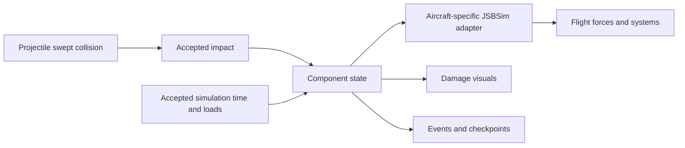

# Physical component damage with JSBSim

Proposed design, 2026-10-25. This implementation does not exist yet. The current
[Health model and alternatives](aircraft-damage.md) remain separate choices.
No F-35B damage characteristics, material thresholds or CPU budgets here are
claimed measured or validated.

## Scope and ownership

JSBSim integrates the aircraft's rigid-body motion and modeled systems. It
does not infer projectile penetration, fracture or aerodynamic changes from
the rendered mesh. This implementation owns component geometry, impact
resolution, persistent damage and reduced physical evolution. Aircraft data
owns the geometry/properties and mapping to its flight model. The flight host
owns accepted-step scheduling; multiplayer owns authority and replication.
Rendering observes state and never advances damage.

Begin in fly's `src/flight/damage/` beside Health. Extract a reusable damage
package when another consumer or model makes that boundary useful. Generic
native mechanisms belong in the JSBSim fork only where XML/property interfaces
cannot express the required behavior. No current native change is required by
the Health implementation.

## Aircraft preparation

Use a modest authored component graph before considering voxelization or
runtime fracture. A first aircraft has separate wing regions/spars, left/right
control surfaces, horizontal/vertical tail, engine, tanks, hydraulic circuits
and relevant flight-control power. Aircraft-specific asymmetry and redundancy
must survive the representation.

Each component definition includes:

- Stable ID and parent/attachment dependencies.
- Collision primitive or prepared volume in a declared aircraft body frame,
  with separate outer skin and internal components where supported.
- Material/model ID, thickness or effective path resistance, mass, local CG
  and local inertia, plus source and uncertainty for each authored quantity.
- Aerodynamic regions/flight effects, structural connections and load paths.
- Fuel/electrical/hydraulic/thermal connections where the aircraft supports them.
- Visible intact/damaged/detached nodes, without using render LOD as hit geometry.

Prepare this data offline. Mesh shape alone does not establish armor, spar
placement, strength or aerodynamic coefficients. Unknown F-35B internals must
be labeled estimates or omitted; a generic transport test does not calibrate
this aircraft. Separate geometry confidence from physical-parameter confidence.

## Impact data and resolution

The accepted envelope has the IDs/time/life/version fields in the parent
design. Its physical payload contains position in body metres, incoming
relative velocity in body m/s, projectile definition and mass in kg, plus any
validated explosive/fragment event definition. Keep a deterministic seed with
an event that uses stochastic effects. Do not accept client-provided arbitrary
damage totals as physical results.

Convert poses' feet/second and projectile metres/second at a single boundary.
Use one documented convention: body x forward, y right, z down. JSBSim XML
force locations use the aircraft's structural datum/conventions and commonly
inches; explicitly convert position, vector and units rather than treating
structural and body coordinates as interchangeable. Test transformed locations
and moment signs on both sides of the aircraft.

Sweep against target motion over the projectile interval, broad phase first.
Walk intersected layers/components in travel order. A conservative or
unresolved answer is reported; exhausting a work cap must not turn an unknown
intersection into a confirmed miss.

For each crossing, calculate relative kinetic energy `E = 0.5 m |v_rel|²`.
Use a declared, calibrated material/path model to partition energy into
remaining projectile energy, deformation/damage and other modeled losses.
Keep the energy ledger nonnegative and bounded by the incident supply. Simple
effective resistance can be an initial reduced model; it must not be described
as measured ballistic penetration without evidence. Account for path angle and
thickness within that model's supported domain.

Resolve impulse from the projectile's momentum change, including any modeled
outgoing projectile/fragments. Deposit it once at the impact location.
Structural energy deposition and rigid-body impulse are separate quantities;
neither justifies a continuing arbitrary push. If feeding impulse through an
external force, use `F = J / accepted_dt` for exactly one accepted interval.
Never repeat it on renders, retries, correction replay or paused reads.

Begin with inert projectiles. Fragmentation/explosions are another mechanism:
specify emission, shielding, total mass/energy accounting and capped sampling,
then validate it separately. A radius-only damage rule belongs to an explicitly
cheaper model, not an unreported fallback inside this one.

## Persistent state and progression

Skin damage, control failure and structural weakening are independent state.
Do not convert a component's one remaining-health fraction into every physical
effect. Suggested reduced state includes attachment, remaining effective
section/strength, aerodynamic damage parameters, actuator mode, leak area,
fluid inventories/pressure, thermal energy and burning state.

For structure, estimate local loads from the modeled distributed aerodynamic
forces and attached masses. Compare bending/shear/torsion demand with residual
capacity. A weakened spar can retain lift at low load and separate during a
later maneuver. A reduced beam/connection model is the first hypothesis; full
finite-element dynamics are an offline reference until their value is shown.
State clearly whether fatigue, flutter, deformation and crack growth are absent.

For a tank puncture, derive a bounded leak rate from the selected leak model,
remaining liquid and pressure/head assumptions. Consume that fuel once through
the native tank flow interface; do not also subtract it from the tank contents
in a second integrator. Model hydraulic leakage and supply separately from an
instant jam; loss of one circuit need not fail every surface.

Thermal/fire models track heat input, cooling, fuel/oxygen availability and
strength changes within their declared scope. Ignition is not automatic for
every fuel hit. Reuse the F135's existing engine/metal state where relevant;
do not maintain a second competing engine temperature or fuel inventory. The
fork's coupled engine plant is not already a projectile-damage model.

Advance continuous processes only on accepted positive simulation time.
Inactive components need no repeated integration. Use events for immediate
changes and explicit coarser scheduling/substeps for processes that need them.
Loads, systems and failures have a declared fixed-step order. Candidate/retry
state commits atomically with its time receipt; rejected physics steps cannot
burn fuel, accumulate heat or trigger irreversible separation twice.

## Coupling to JSBSim

Use the existing property setter for exposed mechanisms:

| Effect | Mechanism and limit |
| --- | --- |
| Surface jam | An actual `<actuator>` exposes `fcs/<name>/malfunction/fail_stuck`; zero/hardover are separate failure modes. A kinematic component does not automatically have actuator failure properties. |
| Fuel leak | `propulsion/tank[n]/external-flow-rate-pps`, negative for a leak. Aggregate every external source/sink through one owner so one feature cannot overwrite another's flow. |
| Engine stall/seizure | Turbine `stalled`/`seized` controls where the loaded engine supports them. Detailed compressor/turbine damage requires explicit plant changes and validation. |
| Asymmetric lift/drag | Damage-dependent XML aerodynamic functions or configured external reactions at the damaged region's station. |
| Mass loss | Predeclared variable point masses, including distributed mass/inertia representation; native total inertia/CG properties are observations, not general writable damage knobs. |

Properties and bindings must be discovered/validated for the loaded aircraft.
Writing an unused custom `damage/...` property does not create a flight effect.
Apply failures downstream of pilot commands so flight-control compensation
can saturate naturally. A lost surface's aerodynamic contribution must also
change; merely zeroing pilot input does not represent surface loss.

The first aero adapter should preserve the intact model and add damage
increments. For a region, a reduced estimate is
`ΔF = q S_region ΔC(alpha, beta, Mach, rates, deflection, damage)`;
use suitable lift/drag/side axes and the corresponding moment changes.
Applying a force at its station gives `r × ΔF` about the current CG. Add only
intrinsic moment increments separately; do not add that lever-arm moment twice.
At zero damage every increment is zero and the baseline trajectory is retained.

Current F-35B XML largely aggregates wing lift and uses a combined roll-control
effect. Author independent left/right damage contributions and control effects
before claiming location-dependent wing behavior. Removing half the total lift
symmetrically cannot represent losing one wing. Tail damage also changes
stability, damping and coupling; area scaling alone is an explicit approximation.

An alternative adapter can split the baseline into component loads. It must
replace the corresponding aggregate contributions rather than adding a second
intact wing. Compare that model against increments as a separate hypothesis.

When structure detaches, remove its aerodynamic contributions and only the
mass/inertia represented for that structure. Do not leave the same wing mass
in both empty weight and removable point masses. Preserve a valid inertia
tensor and specify the retained body's state/CG transformation and any
separation momentum. Native point-mass edits alone do not solve the full
separation impulse problem. Debris can be a simpler separate simulation; its
visual detail must not govern the retained aircraft's physics.

## Multiplayer and reset

Use the implemented host-authorized Shared settings protocol for model choice
and its editing permission. The host-only default, capability agreement,
revision barrier and host-decided guest requests apply equally to this model.
Do not introduce a second aircraft-local physical-model selector that can
diverge between peers. Add a physical capability only once its runtime exists.

Select/agree model ID, version and aircraft damage data at combat-life start.
Use reliable accepted-impact events and bounded checkpoints with life ID and
last applied event. Discard duplicate, stale-life and unauthorized events.
One authority decides state transitions; independently simulated visuals do
not imply identical physical outcomes from different pose histories.

Predict only where reconciliation/state restoration is specified. Peers observe
the owning aircraft's resulting motion; they need not run another full JSBSim
instance for it. Snapshot health is not enough to restore leaks, loads, heat,
controller failures or detached structure. Physical checkpoints include those
states and owned native state, or explicitly prohibit unsupported restoration.

Repair/new life resets damage state, native failure flags, leak flows, mass
representation, thermal policy, adapters and visuals together. Teleport,
pause, tab changes, render LOD and reconnect must not silently heal a component.
No automatic conversion from the Health model's remaining points is defined.

## Acceptance before calling this physical damage

1. **Adapter fixtures:** inject a jam, leak and asymmetric aero increment without
   weapons. Verify healthy equivalence, units, force/moment signs, flight-control
   saturation and reset, against the actual installed WASM aircraft.
2. **Impact fixtures:** moving targets, thin parts, crossings at different step
   boundaries, shielding, repeated events and bounded-work cases. Check energy
   and momentum ledgers independently of visible particles.
3. **Progression fixtures:** low-load survival then load-induced separation,
   leak depletion, thermal heating/cooling, redundant-system loss and safe
   timestep refinement. Compare outcomes with controllers on and off.
4. **Network/lifecycle fixtures:** held aircraft, delayed/duplicate events,
   repairs, old-life traffic, checkpoints and rollback. Verify time is advanced
   once and that prediction cannot cause double damage.
5. **Evidence and cost:** compare authored behavior with independent data over
   the supported envelope, then measure integrated cost under the parent
   design's workloads. Label estimates and unresolved regimes. Keep Health
   and any component model that earns a separate useful tradeoff.

NASA transport damage studies provide independent examples of asymmetric
stability/control effects and incremental aerodynamic modeling. They support
the mechanisms and comparison approach, not F-35B coefficients or thresholds:
[wind-tunnel damage investigation](https://ntrs.nasa.gov/citations/20080034656),
[real-time damaged-aircraft modeling](https://ntrs.nasa.gov/citations/20120014568).

Native contracts to verify against the installed fork:
[actuators](https://github.com/JSBSim-Team/jsbsim/blob/master/src/models/flight_control/FGActuator.cpp),
[tanks](https://github.com/JSBSim-Team/jsbsim/blob/master/src/models/propulsion/FGTank.cpp),
[external forces](https://github.com/JSBSim-Team/jsbsim/blob/master/src/models/FGExternalForce.cpp),
[mass balance](https://github.com/JSBSim-Team/jsbsim/blob/master/src/models/FGMassBalance.cpp).
