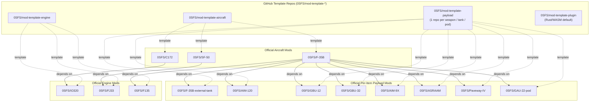
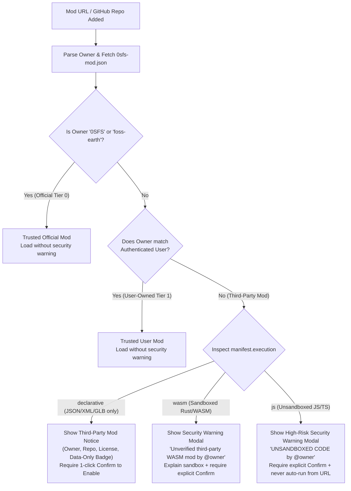

# Specification: GitHub-Centric Modding Architecture and Content Migration

Status: specification and implementation plan, 27 October 2026.
Applies to `0SFS/fly`, `0SFS/aircraft`, `0SFS/engines`, `0SFS/stores`, `0SFS/fuel`, `0SFS/exhaust`, `0SFS/sound`, `0SFS/about`, `0SFS/0SFS.github.io`, the existing aircraft/engine repositories (`0SFS/C172`, `0SFS/SF-50`, `0SFS/F-35B`, `0SFS/IO320`, `0SFS/FJ33`, `0SFS/F135`), and the new per-item payload repositories (`0SFS/AIM-120`, `0SFS/GBU-12`, `0SFS/GBU-32`, `0SFS/AIM-9X`, `0SFS/ASRAAM`, `0SFS/Paveway-IV`, `0SFS/GAU-22-pod`, `0SFS/F-35B-external-tank`).

> **Amendment, 29 October 2026: components and modpacks.** Two kinds join `aircraft`, `engine`, `payload` and `plugin`:
>
> - **`component`**: a part other mods share, such as a propeller (`0SFS/rotating-prop`), a gimbal (`0SFS/camera-gimbal`), a camera (`0SFS/drone-camera`, `0SFS/DJI-FC7303`, `0SFS/DJI-FC3411`), a flight model (`0SFS/multirotor`) or an airframe layer (`0SFS/Quadcopter`, `0SFS/DJI-Quadcopter`). It contributes data an aircraft mod depends on.
> - **`modpack`**: mods installed together. It lists them in `dependencies` and carries no content of its own; `mods/src/schema.ts` refuses a modpack with any content key.
>
> Everything the flight starts with is a mod, brought in by **`0SFS/default-modpack`**: the C172, SF-50, F-35B, DJI Mini 2 and DJI Air 2S aircraft mods and the `0SFS/camera-preview` plugin. The aircraft bring in their engines, payloads and components. fly links the pack and every mod it brings in; `scripts/link-packs.mjs` writes them into `fly/src/flight/mods/bundledMods.ts`, and the mods session installs the pack before the flight reads the aircraft selection. Bundled manifests load with no fetch, and the pack's mods cannot be removed. The sections below predate this amendment where they list four kinds.

> **Active WIP Boundary:** `@0sfs/ground-contact` (ground collisions) is actively being worked on in a separate effort. **Do not inspect, modify, or refactor `@0sfs/ground-contact`** during this migration. Where `FdmProfile.bodyCollisionProbes` is read in `fly/src/flight/jsbsim/fdmProfiles.ts`, retain the existing imported references or provide a pass-through default without touching `ground-contact`.

---

## 1. Objectives and Design Principles

1. **GitHub is the Mod Hosting & Discovery Platform:**
   - Creating a mod is: **Fork a `0SFS/mod-template-*` repository $\to$ edit files $\to$ push to GitHub**.
   - Installing a mod in 0SFS is: **Add the GitHub repository URL (or `owner/repo` shorthand) to the mod list**, or click a `0sfs-mod` repository inside the in-game **Mods** tab.
   - Sharing a modded flight (or hosting modded multiplayer) is a URL parameter: `?mods=owner/repo,owner2/repo2@tag`.
2. **One Repository Per Aircraft, Engine, Weapon, Fuel Tank, or Pod (Eat Our Own Dogfood):**
   - Every distinct piece of equipment is its own self-contained mod repository forked/structured from a template:
     - **One repo per aircraft:** `0SFS/C172`, `0SFS/SF-50`, `0SFS/F-35B`
     - **One repo per engine:** `0SFS/IO320`, `0SFS/FJ33`, `0SFS/F135`
     - **One repo per weapon, pod, or external fuel tank:** `0SFS/AIM-120`, `0SFS/GBU-12`, `0SFS/GBU-32`, `0SFS/AIM-9X`, `0SFS/ASRAAM`, `0SFS/Paveway-IV`, `0SFS/GAU-22-pod`, `0SFS/F-35B-external-tank`
   - An aircraft mod declares the engines and individual payload repos it carries in its `"dependencies"` array. If a community modder builds an F-16C or Eurofighter Typhoon, they simply depend on `"0SFS/AIM-120"`, `"0SFS/AIM-9X"`, `"0SFS/Paveway-IV"`, etc., without duplicating a single weapon!
   - Core repositories (`@0sfs/aircraft`, `@0sfs/engines`, `@0sfs/stores`, `@0sfs/fuel`, `@0sfs/exhaust`, `@0sfs/sound`) hold only **generic simulator machinery and UI panels**, never hardcoded data for a specific plane, engine, fuel tank, or weapon.
3. **Declarative First, Rust/WASM for Code, TS/JS Last Resort:**
   - **Declarative (`execution: "declarative"`):** Pure JSON + JSBSim XML + glTF (`.glb`) + PNG thumbnails. 100% immune to XSS/storage exfiltration, safe for multiplayer auto-sync, and loads with zero code execution warnings.
   - **Rust $\to$ WebAssembly (`execution: "wasm"`):** When custom runtime logic is required (custom fly-by-wire control laws, FADEC/propulsion controllers, custom autopilot modes, ballistic/guidance computers, audio DSP), the default and recommended path in templates is **compiled Rust (`wasm32-unknown-unknown`)** running in an isolated linear-memory sandbox with a deterministic numeric C ABI.
   - **TypeScript / JavaScript (`execution: "js"`):** Supported as a last-resort escape hatch (e.g., for custom DOM/React MFD panels), gated behind the strictest security warning.
4. **DAG Dependency Graph with Single-Instance URL Deduplication:**
   - Mods declare dependencies by URL or `owner/repo` (e.g., `0SFS/F-35B` depends on `0SFS/F135`, `0SFS/F-35B-external-tank`, `0SFS/AIM-120`, `0SFS/AIM-9X`, etc.).
   - Canonical URL normalization guarantees that if $N$ aircraft mods depend on `0SFS/AIM-120` or `0SFS/F135`, it is fetched, hydrated into JSBSim `MEMFS`, and registered **exactly once**, and displayed in the **About** dependency tree alongside core packages.

---

## 2. Terminology: Why `mod-template-payload` Replaces "Stores" in Modding

In military aviation and JSBSim/FlightGear conventions, **"stores"** (short for *external aircraft stores*, as in MIL-STD-1760) means anything carried on hardpoints, pylons, or internal bays (drop tanks, missiles, bombs, pods). That is why `@0sfs/stores` and JSBSim properties like `stores/station[n]/store-id` use the word internally.

However, to modders and general pilots, **"stores" is ambiguous** (easily confused with an app store or state store), whereas **"payload"** is immediately self-explanatory.

### Naming Decision
- **Template Repository Name:** `0SFS/mod-template-payload`
- **Mod Manifest Kind:** `"kind": "payload"`
- **GitHub Discovery Topic:** `0sfs-payload` (alongside `0sfs-mod`)
- **Internal Simulator Boundary:**
  - `@0sfs/stores` and `@0sfs/fuel` remain the internal runtime/UI packages that render the Armament and Fuel panels and write JSBSim `stores/*` and `propulsion/tank[*]` properties.
  - Each **`payload` mod repository** represents **one payload item** (one missile, bomb, gun pod, or external fuel tank) and registers its physical/visual definition into `@0sfs/stores` or `@0sfs/fuel` at runtime.
  - The **aircraft mod** (`0SFS/F-35B`) defines its own stations (`1–11`), bay door geometry, station-to-payload compatibility/mesh fits, and loadout presets, referencing the individual payload mods in its `dependencies`.

---

## 3. Repository Architecture: Core Libraries vs. Mod Templates vs. Content Mods



### 3.1 The Four Mod Template Repositories

All four templates must be created as public GitHub template repositories (`gh repo create 0SFS/<name> --public` with `is_template=true` via `gh api -X PATCH repos/0SFS/<name> -f is_template=true`):

| Template Repository | `kind` | GitHub Topics | Default Execution Mode | Included Scaffolding & CI |
| :--- | :--- | :--- | :--- | :--- |
| **`0SFS/mod-template-aircraft`** | `"aircraft"` | `0sfs-mod`, `0sfs-aircraft` | `"declarative"` (optional `"wasm"` for FBW/control laws) | `public/0sfs-mod.json`, `public/aircraft/<id>/*.glb`, `public/jsbsim-data/aircraft/<id>/*.xml`, station/hardpoint & loadout preset config, optional `crates/control-law/` Rust crate, validation script, GitHub Pages deploy workflow. |
| **`0SFS/mod-template-engine`** | `"engine"` | `0sfs-mod`, `0sfs-engine` | `"declarative"` (optional `"wasm"` for FADEC) | `public/0sfs-mod.json`, `public/jsbsim-data/engine/*.xml`, optional `public/aircraft/<id>/engine/*.glb` (`full` + `installed`), nozzle rig & exhaust optical/gas support definitions, rotor blade counts, acoustic profile. |
| **`0SFS/mod-template-payload`** | `"payload"` | `0sfs-mod`, `0sfs-payload` | `"declarative"` (optional `"wasm"` for guidance/ballistics) | Single-item payload template (for one weapon, bomb, missile, pod, or external fuel tank): `public/0sfs-mod.json`, optional `public/payloads/<key>/*.glb` (or procedural cylinder/box dimensions), mass, drag area, capacity/rounds, and provenance notices. |
| **`0SFS/mod-template-plugin`** | `"plugin"` | `0sfs-mod`, `0sfs-plugin` | **`"wasm"` (Rust default)**; `"js"` fallback documented separately | `Cargo.toml` (`crate-type = ["cdylib"]`, `wasm32-unknown-unknown`, zero-allocation `#![no_std]`-friendly guest SDK), `public/0sfs-mod.json`, `public/mod.wasm`, GitHub Action that compiles Rust $\to$ `.wasm`, verifies exports, and publishes to GitHub Pages. |

---

## 4. The `0sfs-mod.json` Manifest Specification

Every mod serves a `0sfs-mod.json` file at its root (or `public/0sfs-mod.json` in source, published to `/0sfs-mod.json` on GitHub Pages / raw branch).

### 4.1 TypeScript Schema Definition

```ts
export type ModKind = "aircraft" | "engine" | "component" | "payload" | "plugin" | "modpack";
export type ModExecutionMode = "declarative" | "wasm" | "js";

export interface ModDependencySpec {
  /**
   * Canonical GitHub shorthand ("0SFS/F135", "0SFS/AIM-120", "0SFS/F135@v1.0.0")
   * or full HTTPS URL ("https://github.com/0SFS/AIM-120").
   */
  source: string;
  /** Optional expected mod ID for verification after fetch. */
  id?: string;
}

export interface ModProvenance {
  repository: string;       // e.g. "https://github.com/0SFS/AIM-120"
  owner: string;            // e.g. "0SFS"
  commit?: string;          // Stamped by CI or build script
  version?: string;         // e.g. "26.10.27#1" or "0.1.0"
  license: string;          // SPDX identifier, e.g. "AGPL-3.0-only" or "CC-BY-4.0"
  authors: readonly string[];
  noticeFiles?: readonly string[];
}

export interface ModWasmEntry {
  /** Path relative to the mod's baseUrl, e.g. "wasm/f35b_fcs.wasm". */
  path: string;
  /** SHA-256 hex digest of the compiled .wasm binary for integrity verification. */
  sha256?: string;
  /** JSBSim properties read into the input buffer before each `osfs_mod_step` call. */
  readProperties: readonly string[];
  /** JSBSim properties written from the output buffer after each `osfs_mod_step` call. */
  writeProperties: readonly string[];
}

export interface ModJsEntry {
  /** Last-resort ES module path relative to baseUrl, e.g. "mod.js". */
  path: string;
}

export interface OsfsModManifest {
  schemaVersion: 1;
  /** Globally unique mod identifier, e.g. "0sfs/c172", "0sfs/aim-120", or "alice/f-16c". */
  id: string;
  kind: ModKind;
  name: string;
  summary: string;
  /**
   * Automatically inferred and strictly verified at load time:
   * - "declarative" if neither `wasm` nor `js` is present
   * - "wasm" if `wasm` is present and `js` is absent
   * - "js" if `js` is present
   */
  execution: ModExecutionMode;
  provenance: ModProvenance;
  /**
   * Other mods that must be loaded and registered before this mod activates.
   * Deduplicated globally by canonical URL.
   */
  dependencies?: readonly (string | ModDependencySpec)[];
  /** JSBSim XML files served by this mod, relative to `${baseUrl}/jsbsim-data/`. */
  jsbsimFiles?: readonly string[];
  /** Contribution payloads by kind. */
  aircraft?: ModAircraftContribution;
  engine?: ModEngineContribution;
  payload?: ModPayloadContribution;
  /** Optional sandboxed Rust/WASM module for control laws, FADEC, guidance, or plugins. */
  wasm?: ModWasmEntry;
  /** Optional unsandboxed JS module (last resort; triggers strict security warning). */
  js?: ModJsEntry;
}
```

### 4.2 Contribution Payloads (`engine`, `payload`, `aircraft`)

1. **`ModEngineContribution` (`kind: "engine"` — 1 repo per engine):**
   - `id`: Engine identifier (e.g. `"io320"`, `"fj33-5a"`, `"f135-pw-600"`).
   - `label`, `summary`, `type`: `"piston" | "turbine"`.
   - `jsbsimEngineFiles`: Array of paths in `jsbsim-data/` (e.g. `["engine/eng_io320.xml", "engine/prop_75in2f.xml"]`).
   - `rotorBlades`: `EngineRotorBladeCounts` (migrated from `@0sfs/engines/engineRotorDefinitions`).
   - `startSpeed`: `{ property: string; runningAt: number }`.
   - `maxEngineRpm?`: `number`.
   - `gauges`: `{ primary: string; secondary: string | null; label: string }`.
   - `engineAssets?`: `{ full: { path: string; triangles: number }; installed: { path: string; triangles: number }; rig?: EngineNozzleRigDefinition }`.
   - `exhaustOpticalProfiles?`: `EngineExhaustOpticalProfile[]`.
   - `gasSupport?`: `EngineGasSupportDefinition`.
   - `acousticProfile?`: Engine acoustic definition for `@0sfs/sound`.

2. **`ModPayloadContribution` (`kind: "payload"` — 1 repo per weapon, pod, or fuel tank):**
   - Discriminated by `payloadType: "store" | "external-tank"`:
   - **When `payloadType === "store"` (e.g. `0SFS/AIM-120`, `0SFS/GBU-12`, `0SFS/GAU-22-pod`):**
     - `store`: `{ id: number; key: string; label: string; massLbs: number; dragAreaFt2: number; lengthM: number | null; diameterM: number | null; spanM: number | null; boxM: { length: number; width: number; height: number } | null; meshStandIn: boolean; meshPath?: string; rounds: number | null; massNote: string | null }`
     - Intrinsic to the weapon/pod itself so any aircraft mod can mount it on its stations.
   - **When `payloadType === "external-tank"` (e.g. `0SFS/F-35B-external-tank`):**
     - `tank`: `{ key: string; label: string; capacityLbs: number; dryWeightLbs: number; meshPath: string; credit?: AircraftModelCredit }`
     - Intrinsic tank properties (capacity, dry mass, `.glb` mesh path, and provenance), while the aircraft specifies which stations/tank indices mount it and at what structural coordinates.

3. **`ModAircraftContribution` (`kind: "aircraft"` — 1 repo per aircraft family):**
   - `family`: `AircraftFamilyDefinition` (all asset paths relative to the mod's `baseUrl`).
   - `definitions`: `readonly AircraftDefinition[]`.
   - `fdmProfiles`: `Readonly<Record<string, FdmProfile>>`.
   - `payloadInstallation?`: Aircraft-specific hardpoints and clearances linking to the payload mods in `dependencies`:
     - `structuralReferenceIn`: `{ x: number; y: number; z: number }`
     - `weaponPayloadLimitLbs`: `number`
     - `stations`: `readonly StationDefinition[]`
     - `stationClearances`: `Readonly<Record<string, { stations: readonly number[]; ratingException?: { stations: readonly number[]; cellLbs: number } | null }>>` (maps payload `key` like `"aim-120"` to cleared stations `[4, 5, 7, 8]`)
     - `refusedStores?`: `readonly { key: string; label: string; refusal: string }[]`
     - `meshFits`: `Readonly<Record<StationDefinition["place"], Readonly<Record<string, StoreMeshFit>>>>`
     - `presets`: `readonly StorePreset[]`
     - `externalTankInstallations?`: `readonly { tankKey: string; index: number; label: string; attachmentProperty: string; locationIn: { x: number; y: number; z: number } }[]`
     - `bayDoors?`: Bay door geometry & fuselage bounds for internal-bay aircraft.

---

## 5. Rust/WASM Mod ABI Specification (Default for Code Mods)

To avoid the fragility, GC pauses, and security surface of arbitrary JavaScript, **any mod that needs custom per-frame computation must use Rust compiled to standalone WebAssembly (`wasm32-unknown-unknown`) by default**, following the proven pattern in `sound/scripts/build-audio-wasm.mjs`.

### 5.1 Sandbox Guarantees
- Instantiated via `WebAssembly.instantiate(bytes, { env: {} })` with **zero host imports** (no `fetch`, no DOM access, no `localStorage`, no `eval`, no network).
- Bounded linear memory: maximum memory pages capped in the WASM binary header (default limit: 16 MB; audio/DSP plugins: 4 MB).
- Zero heap allocations inside `osfs_mod_step`: all input/output property arrays are pre-allocated during `osfs_mod_init`.
- Per-frame execution time budget monitored via `performance.now()`; if a third-party mod exceeds its frame budget repeatedly, the host disables the mod's step callback and logs a diagnostic without crashing the flight.

### 5.2 Required C ABI Exports (`mod-template-plugin` & `crates/osfs-mod-sdk`)

```rust
// Exported by the Rust mod via `#[no_mangle] pub extern "C" fn ...`
pub extern "C" fn osfs_mod_abi_version() -> u32; // Returns 1
pub extern "C" fn osfs_mod_init(sample_rate_hz: f64, num_inputs: u32, num_outputs: u32) -> i32;
pub extern "C" fn osfs_mod_reset();
pub extern "C" fn osfs_mod_input_ptr() -> *mut f64;
pub extern "C" fn osfs_mod_output_ptr() -> *const f64;
pub extern "C" fn osfs_mod_step(dt_sec: f64) -> i32;
```

On every physics tick:
1. The host copies the current values of the manifest's `wasm.readProperties` from JSBSim into `f64` slice at `osfs_mod_input_ptr()`.
2. The host calls `osfs_mod_step(dt_sec)`.
3. The host writes the `f64` slice at `osfs_mod_output_ptr()` back into JSBSim's `wasm.writeProperties`.

---

## 6. URL Resolution, Dependency DAG, Deduplication & About Tree

### 6.1 Canonical URL Resolution & Single-Instance Deduplication

Users and mod `dependencies` arrays may specify a mod in any of these forms:
1. **GitHub Shorthand:** `0SFS/F135`, `0SFS/AIM-120`, `alice/my-plane`, `alice/my-plane@v1.2.0`
2. **GitHub Repo URL:** `https://github.com/0SFS/AIM-120`, `https://github.com/alice/my-plane/tree/main`
3. **GitHub Pages URL:** `https://alice.github.io/my-plane/`
4. **Direct Manifest URL (Local Dev / Custom CDN):** `http://localhost:7471/0sfs-mod.json`

**Canonicalization Rules (`normalizeModSource`):**
- Built-in bundled first-party mods resolve in local dev/offline builds to `/mods/<repo-lower>/0sfs-mod.json` (while preserving their canonical identity `github:0sfs/<repo-lower>@HEAD`).
- Any GitHub shorthand or `github.com/<owner>/<repo>[@<ref>]` normalizes to the canonical key:
  $$\text{key} = \texttt{github:}\langle\text{owner\_lower}\rangle\texttt{/}\langle\text{repo\_lower}\rangle\texttt{@}\langle\text{ref} \parallel \texttt{HEAD}\rangle$$

**Deduplication Invariant:**
- `ModRegistry` stores `loadedModsByCanonicalKey: Map<string, Promise<LoadedModRecord>>` and `loadedModsById: Map<string, LoadedModRecord>`.
- When resolving a dependency graph:
  - If `0SFS/F-35B` and a community `alice/F-16C` both depend on `"0SFS/AIM-120"` and `"0SFS/AIM-9X"`, both normalize to `github:0sfs/aim-120@HEAD` and `github:0sfs/aim-9x@HEAD`.
  - The second lookup hits the existing Promise in `loadedModsByCanonicalKey`. Only **one** network fetch, **one** `MEMFS` hydration, and **one** store/engine registration ever occur.
  - Circular dependencies ($A \to B \to A$) are detected during DFS traversal via a `visiting: Set<string>` stack and rejected with a clear diagnostic error (`Circular mod dependency: A -> B -> A`).

### 6.2 Integration with the `About` Dependency Tree

In `fly/src/flight/createFlightSimApp.ts`, `createAboutPanel` reads `#foss-earth-built-from`.
- Extend the About integration so that all active mods appear in the About dependency graph (`parts`), structured identically to `BuiltFromNode`:
  - Each top-level mod (the default modpack, then any mod added on top of it) is listed with its `name`, `from: "mod"`, `version`, `commit`, `repository`, and `history`.
  - Every dependency appears under the mod that needs it: the pack's aircraft and plugins under the pack, and engines, payloads and components under the aircraft.
  - Its engine and payload `dependencies` (`0SFS/F135`, `0SFS/F-35B-external-tank`, `0SFS/AIM-120`, `0SFS/GBU-12`, `0SFS/GBU-32`, `0SFS/AIM-9X`, `0SFS/ASRAAM`, `0SFS/Paveway-IV`, `0SFS/GAU-22-pod`) appear as nested `parts` under the aircraft mod.
  - Shared dependencies (e.g. `0SFS/AIM-120` used by two aircraft mods) expand their subtree on first appearance and render as a compact deduplicated reference on subsequent appearances.

---

## 7. Discovery via GitHub Topics & Security / Ownership Model

### 7.1 GitHub Topic Tagging & Unauthenticated Discovery
- Every `0SFS` mod and template repository must be tagged with GitHub topics:
  - Universal topic: **`0sfs-mod`**
  - Kind topic: **`0sfs-aircraft`**, **`0sfs-engine`**, **`0sfs-component`**, **`0sfs-payload`**, **`0sfs-plugin`**, or **`0sfs-modpack`**
- The **Mods** tab includes a **Browse GitHub Mods** section that queries:
  `GET https://api.github.com/search/repositories?q=topic:0sfs-mod&sort=stars&order=desc&per_page=30`
- Results are cached in `sessionStorage` (with a 10-minute TTL and ETag support) so normal tab switches never hit GitHub's 60 req/hr unauthenticated rate limit.

### 7.2 Ownership Verification & Security Warnings

Every mod's repository owner (`provenance.owner` and the parsed URL owner — which must match if loaded from GitHub) is evaluated against three ownership tiers:



1. **Identity Provider Hook (`ViewerIdentity`):**
   - Define a clean interface in the mod loader:
     ```ts
     export interface ViewerIdentity {
       githubUsername?: string | null;
       authenticatedProvider?: "github" | "google" | "microsoft" | "email" | null;
     }
     ```
   - Today (pre-login): reads an optional developer setting (`osfs.mods.developerGithubUsername` in local settings, defaulting to `null`).
   - Future (when FOSS Earth login with Google/MS/GH/email lands): the auth session supplies `viewerIdentity.githubUsername` automatically.
2. **Mandatory Warning Rules for Non-`0SFS`, Non-User Repos:**
   - If `owner.toLowerCase() !== "0sfs"` and `owner.toLowerCase() !== "foss-earth"` and `owner.toLowerCase() !== viewerIdentity.githubUsername?.toLowerCase()`:
     - The UI **must** display a clear **Security Warning** before activating the mod or any transitive third-party dependency not owned by `0SFS` or the user.

---

## 8. Migration Inventory: Every Existing Item Becomes a Mod Repo

### 8.1 Three Engine Mod Repositories (`0SFS/mod-template-engine`)

| Repository | Mod ID | Migrated Contents |
| :--- | :--- | :--- |
| **`0SFS/IO320`** | `"0sfs/io320"` | `public/0sfs-mod.json`, `eng_io320.xml`, `prop_75in2f.xml` (moved from `C172`), `C172_ROTOR_BLADES`, start speed (`runningAt: 480`, `maxEngineRpm: 2700`), gauges, IO-320 acoustic profile. |
| **`0SFS/FJ33`** | `"0sfs/fj33"` | `public/0sfs-mod.json`, `fj33_5a.xml`, `direct.xml`, `FJ33_ROTOR_BLADES`, start speed (`runningAt: 53.4`), gauges, FJ33-5A acoustic profile. |
| **`0SFS/F135`** | `"0sfs/f135"` | `public/0sfs-mod.json`, plant & empirical `F135-PW-600.xml`, `F135-PW-600-full.glb` & `installed.glb`, `F135_ENGINE_GEOMETRY`, nozzle rig, `f135ExhaustOpticalData`, `F135_ROTOR_BLADES`, F135 acoustic profile. |

### 8.2 Eight Individual Payload Mod Repositories (`0SFS/mod-template-payload`)

Each selectable weapon, pod, and external fuel tank is extracted into its own dedicated repository in `/Users/felg/gh/0sfs/<repo>` (structured from `0SFS/mod-template-payload`, tagged `0sfs-mod` and `0sfs-payload`):

| New Payload Repository | Mod ID | `payloadType` | Item Data Migrated Into `public/0sfs-mod.json` (& `public/`) |
| :--- | :--- | :--- | :--- |
| **`0SFS/AIM-120`** | `"0sfs/aim-120"` | `"store"` | `id: 1`, `key: "aim-120"`, `label: "AIM-120"`, `massLbs: 356`, `dragAreaFt2: diskFt2(7)`, `lengthM: 3.6576`, `diameterM: 0.1778`, `spanM: 0.4826`, `meshStandIn: false`, NAVAIR mass note & `Stores.NOTICE.md` provenance. |
| **`0SFS/GBU-12`** | `"0sfs/gbu-12"` | `"store"` | `id: 2`, `key: "gbu-12"`, `label: "GBU-12"`, `massLbs: 500`, `dragAreaFt2: 1`, `lengthM: 3.2766`, `diameterM: 0.3556`, `meshStandIn: true`, class mass note & provenance. |
| **`0SFS/GBU-32`** | `"0sfs/gbu-32"` | `"store"` | `id: 3`, `key: "gbu-32"`, `label: "GBU-32"`, `massLbs: 1013`, `dragAreaFt2: 1`, `lengthM: 3.0353`, `diameterM: 0.3556`, `spanM: 0.49784`, `meshStandIn: true`, mass note & provenance. |
| **`0SFS/AIM-9X`** | `"0sfs/aim-9x"` | `"store"` | `id: 4`, `key: "aim-9x"`, `label: "AIM-9X"`, `massLbs: 186`, `dragAreaFt2: diskFt2(5)`, `lengthM: 3.01752`, `diameterM: 0.127`, `spanM: 0.44704`, `meshStandIn: false`. |
| **`0SFS/ASRAAM`** | `"0sfs/asraam"` | `"store"` | `id: 5`, `key: "asraam"`, `label: "ASRAAM"`, `massLbs: 194`, `dragAreaFt2: diskFt2(166 / 25.4)`, `lengthM: 2.9`, `diameterM: 0.166`, `meshStandIn: false`, mass note. |
| **`0SFS/Paveway-IV`** | `"0sfs/paveway-iv"` | `"store"` | `id: 6`, `key: "paveway-iv"`, `label: "Paveway IV"`, `massLbs: 500`, `dragAreaFt2: 1`, `lengthM: 3.048`, `diameterM: 0.3556`, `meshStandIn: true`, mass note. |
| **`0SFS/GAU-22-pod`** | `"0sfs/gau-22-pod"` | `"store"` | `id: 7`, `key: "gau-22-pod"`, `label: "GAU-22/A pod"`, `massLbs: 1017`, `dragAreaFt2: 6`, `boxM: { length: 3.7084, width: 0.6858, height: 0.8128 }`, `rounds: 220`, `meshStandIn: false`, mass note. |
| **`0SFS/F-35B-external-tank`** | `"0sfs/f-35b-external-tank"` | `"external-tank"` | `key: "f-35b-425gal-tank"`, `label: "425 gal external fuel tank"`, `capacityLbs: 2991`, `dryWeightLbs: 300`, `public/aircraft/f-35b/ExternalTank_FlightGear.glb`, `ExternalTank_FlightGear.NOTICE.md`, `ExternalTank_FlightGear.provenance.json`, `ExternalTank_LICENSE-GPL-3.0.txt` (moved from `F-35B/public/`). |

### 8.3 Three Aircraft Mod Repositories (`0SFS/mod-template-aircraft`)

| Repository | Mod ID | Declared `dependencies` | Migrated Contents into Repo |
| :--- | :--- | :--- | :--- |
| **`0SFS/C172`** | `"0sfs/c172"` | `["0SFS/IO320"]` | `public/0sfs-mod.json`, `cessna-172` family & `AircraftDefinition` (`C172_LODS`, credits), `C172` `FdmProfile`, existing `.glb` meshes, thumbnail, and `c172p/*.xml`. |
| **`0SFS/SF-50`** | `"0sfs/sf-50"` | `["0SFS/FJ33"]` | `public/0sfs-mod.json`, `cirrus-vision-jet` family (`G1`, `G2`, `G2+`, `G3`) & `CIRRUS_LODS`, `FdmProfile`s for G1/G2/G3, existing `.glb` meshes, thumbnail, and `sf50*/*.xml`. |
| **`0SFS/F-35B`** | `"0sfs/f-35b"` | `["0SFS/F135", "0SFS/F-35B-external-tank", "0SFS/AIM-120", "0SFS/GBU-12", "0SFS/GBU-32", "0SFS/AIM-9X", "0SFS/ASRAAM", "0SFS/Paveway-IV", "0SFS/GAU-22-pod"]` | `public/0sfs-mod.json`, `f-35b` family & `AircraftDefinition`, `f-35b` `FdmProfile` (plant & empirical), `payloadInstallation` (F-35B `STATIONS` 1–11, `STORE_MESH_FITS`, station clearances, refused store cards, `STORE_PRESETS`, left/right external tank mounting coordinates, and AF267 bay door geometry). |

---

## 9. Preserving Existing Build, Test, and Landing-Page Invariants

1. **Zero Regression on Startup Speed (`boot:first-frame` / `boot:content`):**
   - All built-in official mods (`C172`, `SF-50`, `F-35B`, `IO320`, `FJ33`, `F135`, and the 8 payload repos) are linked into `fly/public/` via `scripts/link-packs.mjs` and their manifests are bundled into the initial fleet registration so **first-frame boot requires zero extra network round-trips** compared to today.
2. **Landing Page Verification (`0sfs.github.io/scripts/build.mjs`):**
   - `checkAircraft(landing, scripts)` in `0sfs.github.io/scripts/build.mjs` verifies that the compiled flight bundle contains the default aircraft family thumbnails (`aircraft/thumbnails/cessna-172.png`, `aircraft/thumbnails/cirrus-vision-jet.png`, `aircraft/thumbnails/f-35b.png`) in catalog order, along with their labels, summaries, and development notes.
   - Bundling the default mods' `0sfs-mod.json` manifests into the initial fleet bootstrap in `fly/src/flight/aircraft/fleet.ts` preserves this exact invariant without weakening `0sfs.github.io/scripts/build.mjs`.
3. **JSBSim `manifest.json` Compatibility:**
   - `link-packs.mjs` merges the `jsbsimFiles` from linked `@0sfs/*` mod packages (and their declared `@0sfs/*` dependencies) into `fly/public/jsbsim-data/manifest.json` at prebuild/pretest time, while `hydrateJsbsimData.ts` gains support for loading external mod `0sfs-mod.json` file lists from a remote `baseUrl`.
4. **Mods Tab UI:**
   - Add a **Mods** tab in the simulator's tabbed interface showing:
     1. **Installed Mods & Dependency Tree** (Aircraft $\to$ Engines & Individual Payloads)
     2. **Add Mod by URL / GitHub Shorthand** (with ownership check & Security Warning modal)
     3. **Browse GitHub Mods (`topic:0sfs-mod`)** (filterable by `All`, `Aircraft`, `Engines`, `Components`, `Payloads`, `Plugins`, `Modpacks`)
     4. **Share Modded Flight Link** (`?mods=...`)

---

## 10. Phased Implementation Plan & Verification Gates

| Phase | Scope | Verification / Exit Criteria |
| :--- | :--- | :--- |
| **Phase 1: Mod SDK, Schema & Runtime Loader** | Define `0sfs-mod.json` schema, URL canonicalization, DAG resolver with single-instance deduplication, Rust/WASM C ABI runner, ownership/security classifier, and dynamic registration hooks in `@0sfs/aircraft`, `@0sfs/engines`, `@0sfs/stores`, `@0sfs/fuel`, and `@0sfs/about`. | Unit tests for: URL normalization, diamond dependency deduplication ($A \to B, C$ and $B, C \to D$ loads $D$ once), circular dependency rejection, security warning trigger for non-`0SFS`/non-user owners, and WASM step execution. |
| **Phase 2: Create the 4 Mod Templates** | Create local checkouts for `mod-template-aircraft`, `mod-template-engine`, `mod-template-payload` (single weapon/tank/pod template), and `mod-template-plugin` (with Rust/WASM default). Include `validate-mod.mjs` and GitHub Actions workflows. | Each template passes `node scripts/validate-mod.mjs`; `mod-template-plugin` compiles a minimal Rust `wasm32-unknown-unknown` binary and passes ABI verification. |
| **Phase 3: Create the 8 Payload Mod Repos & Migrate Engines** | Create `/Users/felg/gh/0sfs/{AIM-120,GBU-12,GBU-32,AIM-9X,ASRAAM,Paveway-IV,GAU-22-pod,F-35B-external-tank}` from `mod-template-payload`. Migrate `IO320`, `FJ33`, `F135` to `mod-template-engine` structure. Update `@0sfs/stores` and `@0sfs/fuel` to populate their catalogs from the registered payload mods. | All existing engine, exhaust, fuel, and store unit/integration tests pass (`vitest run`), with `STORE_CARDS` and `getExternalTankDefinitions` populated by the individual payload mods. |
| **Phase 4: Migrate Aircraft (`C172`, `SF-50`, `F-35B`) to Mods** | Move aircraft catalog definitions, station/payload clearances, and FDM profiles (except `ground-contact` probes which remain untouched via pass-through) into `C172`, `SF-50`, and `F-35B` with explicit dependencies on their engine and individual payload repos. | `npm test`, `npm run typecheck`, `npm run lint`, and `npm run build` pass in `fly`; `0sfs.github.io` build (`checkAircraft`) passes. |
| **Phase 5: Mods Tab UI, GitHub Topic Browser & About Graph** | Add the **Mods** tab in `fly`, wire `?mods=` URL parameter handling, GitHub `topic:0sfs-mod` search, security warning modal, and `@0sfs/about` dependency graph integration. | Headless Chrome & unit tests verify adding a mod by URL, deduplicating shared weapon/engine dependencies, showing security warnings for third-party owners, and rendering the full mod dependency tree in About. |
